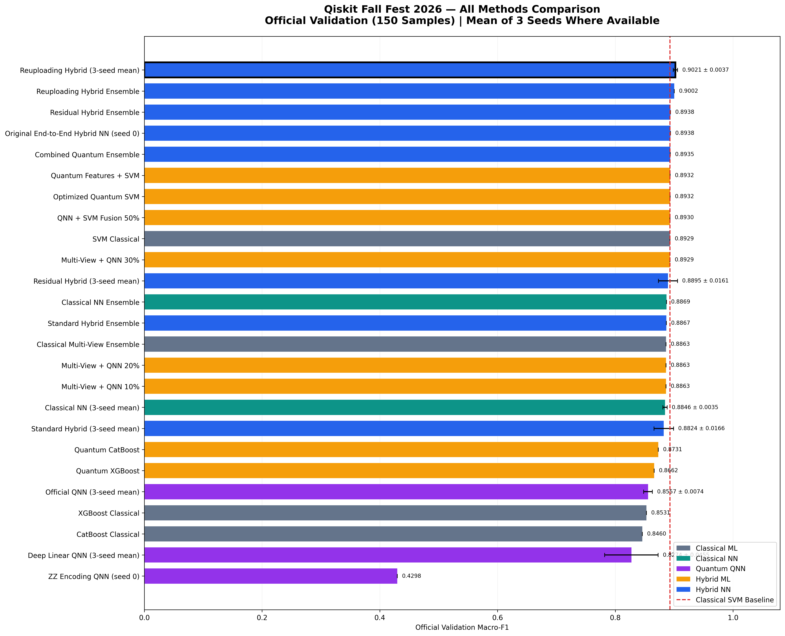

# 🌾 QuantumCrop-QNN-Optimization

### Quantum Crop Classification | Qiskit Fall Fest 2026 — EMSI Quantum Africa

An experimental investigation of **Classical Machine Learning, Quantum Neural Networks (QNNs), Quantum Kernel Methods, and Hybrid Quantum-Classical Deep Learning** for agricultural crop classification using spectral data.

Our objective is to design, optimize, and evaluate quantum-enhanced classifiers while maintaining rigorous comparisons with classical machine learning models.

**Challenge:** Moroccan Crop Classification Challenge  
**Crop classes:** Alfalfa, Maize, Wheat  
**Best stable model:** Reuploading Hybrid Quantum Neural Network  
**Best mean Macro-F1:** 0.9021 ± 0.0037  
**Best individual Macro-F1:** 0.9067 — Residual Hybrid QNN  
**Real quantum hardware:** IBM Fez (`ibm_fez`)  
**IBM hardware experiment:** Successfully completed

> **Important:** All reported classification Macro-F1 scores refer to the official 150-sample validation dataset unless explicitly stated otherwise. The 221 official test samples are unlabeled; their performance cannot be calculated locally.

---

## 📑 Table of Contents

1. Project Overview
2. Dataset Description
3. Exploratory Data Analysis
4. Data Preprocessing
5. Classical Machine Learning Experiments
6. Variational Quantum Classifiers
7. Quantum Feature Augmentation
8. End-to-End Hybrid Quantum Neural Networks
9. Advanced Hybrid Architectures
10. Quantum Kernel SVM
11. Complete Experimental Results
12. IBM Quantum Hardware Experiment
13. Official Test Predictions
14. Repository Structure
15. Reproducibility
16. Scientific Discussion and Limitations
17. Future Improvements
18. References

---

## 1. Project Overview

### Background

Agricultural crop classification is an important application of machine learning and remote sensing.

Spectral measurements collected from satellite observations can help distinguish different types of crops based on their spectral characteristics.

In this project, we investigate whether quantum machine learning can provide useful representations for distinguishing agricultural crops.

Our classification problem contains three categories:

- **Alfalfa**
- **Maize**
- **Wheat**

### Research Objectives

Our work focuses on five fundamental questions:

1. How well do classical machine learning algorithms perform on this dataset?
2. Can variational quantum circuits achieve competitive classification performance?
3. How do quantum encoding, circuit architecture, and parameter initialization influence classification?
4. Can hybrid quantum-classical neural networks improve predictive performance?
5. Can our trained quantum circuit successfully perform inference on real IBM Quantum hardware?

### Main Contributions

We implemented and evaluated:

- Classical machine learning baselines.
- Hyperparameter optimization using Optuna.
- Variational Quantum Classifiers.
- Quantum feature encoding experiments.
- Quantum circuit architecture optimization.
- Quantum-classical probability fusion.
- Quantum feature augmentation.
- Hybrid Quantum Neural Networks.
- Residual Hybrid Quantum Networks.
- Data Reuploading Quantum Networks.
- Multi-seed ensemble learning.
- Quantum Kernel SVM.
- Real IBM Quantum hardware inference.

---

## 2. Dataset Description

The official challenge provides a dataset containing **13 numerical spectral features** for three-class crop classification.

### Dataset Splits

| Dataset | Samples | Labels | Purpose |
|---|---:|---|---|
| Training | 914 | Available | Model training |
| Official Validation | 150 | Available | Model comparison |
| Official Test | 221 | Hidden | Final prediction generation |

The official validation dataset contains 50 observations per class.

### Training Class Distribution

| Crop | Samples |
|---|---:|
| Wheat | 425 |
| Alfalfa | 247 |
| Maize | 242 |
| **Total** | **914** |

The training dataset is moderately imbalanced.

The imbalance ratio between the largest and smallest class is approximately 1.76.

### Evaluation Metric

The primary metric is **Macro-F1**:

\[
F1_{macro}=\frac{1}{3}\sum_{c=1}^{3}F1_c
\]

Macro-F1 gives equal importance to each crop class.

This is particularly relevant because the training dataset contains different numbers of observations for each crop.

We additionally report:

- Accuracy
- Precision
- Recall
- Confusion matrices
- Training time
- Seed-to-seed variability

---

## 3. Exploratory Data Analysis

We performed exploratory data analysis before training the classification models.

### 3.1 Data Quality

The training dataset was examined for:

- Missing values
- Duplicate observations
- Infinite values
- Incorrect numerical types
- Class distribution

The initial data-quality audit identified no missing, duplicate, or infinite observations.

### 3.2 Feature Distributions

We analyzed spectral feature distributions and identified differences between crop classes.

Features including B3 and B11 exhibited notable outlier behavior.

### 3.3 Correlation Analysis

We calculated Pearson correlation coefficients between spectral features.

**18 feature pairs** had an absolute correlation coefficient greater than or equal to 0.85.

This indicates substantial redundancy between some input features.

### 3.4 Principal Component Analysis

PCA was applied to investigate the intrinsic dimensionality of the dataset.

The first three principal components explained approximately **95% of the total variance**.

We subsequently evaluated several feature representations:

- Original 13 features
- PCA with 4 components
- PCA with 6 components
- PCA with 8 components
- Mutual Information feature selection

The 4-dimensional representation was particularly relevant for our 4-qubit quantum models.

### 3.5 Dataset Shift

We also investigated feature-distribution differences between training, validation, and test data.

Some differences were observed, motivating careful evaluation on the official validation dataset.

---

## 4. Data Preprocessing

### Classical Models

For algorithms sensitive to feature scaling, we used:

**StandardScaler**

\[
x'=\frac{x-\mu}{\sigma}
\]

Classical models were trained on either the original spectral features or PCA-transformed representations.

### Quantum Models

The official reference QNN used:

StandardScaler → PCA(4) → StandardScaler

This pipeline transforms the 13 original features into 4 numerical values suitable for the quantum encoding circuit.

### Hybrid Neural Networks

Our advanced Hybrid QNN models used:

1. StandardScaler on the 13 numerical input features.
2. A classical neural network to learn a 4-dimensional representation.
3. Quantum rotation-angle encoding.
4. Quantum expectation measurements.
5. A classical classification head.

All preprocessing parameters used for final evaluation were fitted on the training data.

### Data Leakage Considerations

Some early exploratory cross-validation experiments fitted PCA before splitting the training folds.

Such results may be optimistic.

Likewise, quantum feature augmentation using a QNN already trained on all training samples requires an out-of-fold procedure for a fully unbiased comparison.

These limitations are explicitly acknowledged in our analysis.

---

## 5. Classical Machine Learning Experiments

We began with classical machine learning to establish competitive baselines.

### Algorithms Evaluated

- Logistic Regression
- Support Vector Machine
- Random Forest
- ExtraTrees
- XGBoost
- LightGBM
- CatBoost
- Multilayer Perceptron

Different feature representations and regularization settings were investigated.

### 5.1 SVM Optimization

We experimented with RBF SVM regularization values and feature representations.

For PCA-6, a regularization experiment selected:

C = 100

Results:

| Metric | Score |
|---|---:|
| Training CV Macro-F1 | 0.9174 |
| Training Macro-F1 | 0.9567 |
| Generalization gap | 0.0393 |

### 5.2 Class Imbalance Experiments

The following approaches were investigated:

- Unweighted training
- Balanced class weights
- RandomOverSampler
- RandomUnderSampler
- SMOTE
- BorderlineSMOTE
- ADASYN
- SMOTETomek
- SMOTEENN

In our SVM experiments, none of these approaches outperformed the unweighted baseline.

For example:

| Strategy | CV Macro-F1 |
|---|---:|
| Unweighted SVM | 0.9174 |
| Balanced class weights | 0.9070 |

Therefore, we did not adopt synthetic oversampling for the selected final model.

### 5.3 Optuna Hyperparameter Optimization

We performed 30 Optuna trials for each of the following algorithms:

- XGBoost
- CatBoost
- SVM
- ExtraTrees

Using five-fold stratified cross-validation:

| Algorithm | Best CV Macro-F1 | Representation |
|---|---:|---|
| **XGBoost** | **0.926406** | PCA-6 |
| CatBoost | 0.923014 | PCA-6 |
| SVM | 0.921637 | Original features |
| ExtraTrees | 0.920550 | PCA-6 |

**Important:** These values were obtained using cross-validation on the training dataset. They are not official validation scores.

### 5.4 Best Classical SVM

Our strongest classical model confirmed on official validation was the optimized RBF SVM.

Parameters:

```python
SVC(
    kernel="rbf",
    C=270.4578963550736,
    gamma=0.027548394540701737
)
```

Official validation results:

| Metric | Result |
|---|---:|
| Macro-F1 | **0.892904** |
| Accuracy | **0.893333** |
| Correct predictions | 134 / 150 |

Confusion matrix:

```text
[[47, 0, 3],
 [ 2,45, 3],
 [ 3, 5,42]]
```

This SVM became our principal classical reference model.

### 5.5 Official Boosting Results

| Model | Official Macro-F1 |
|---|---:|
| SVM Classical | **0.892904** |
| XGBoost Classical | 0.853061 |
| CatBoost Classical | 0.845962 |

These results illustrate why high cross-validation performance does not necessarily translate into equally high performance on a separate validation dataset.

---

## 6. Variational Quantum Classifiers

After establishing classical baselines, we investigated quantum classification methods.

### 6.1 Initial VQC

Our first Variational Quantum Classifier used:

- 4 qubits
- ZZ feature map
- Variational rotations
- COBYLA optimization
- Three output classes

Initial official validation Macro-F1:

**0.2953**

After correcting the interpretation of measurement outcomes for three-class classification:

**0.4705**

Although improved, this remained significantly below the classical baseline.

### 6.2 Official Reference QNN

We reproduced the reference classifier supplied in the challenge repository.

Architecture:

- 4 qubits
- RY feature encoding
- 8 trainable quantum parameters
- 3 CX gates
- Approximate circuit depth: 6
- COBYLA optimizer
- 100 objective evaluations
- Exact quantum sampling

The input preparation used PCA-4 and standardization.

Results:

| Metric | Value |
|---|---:|
| Seed 0 Macro-F1 | 0.847300 |
| Three-seed Mean Macro-F1 | **0.855694** |
| Standard deviation | 0.007382 |

### 6.3 Quantum Encoding Comparison

We compared RY and ZZ quantum encoding.

| Encoding | Official Macro-F1 |
|---|---:|
| **RY** | **0.8473** |
| ZZ | 0.4298 |

RY encoding significantly outperformed ZZ in this tested configuration.

The ZZ encoding also produced a deeper circuit with more entangling gates.

This does not establish that RY encoding is always superior; it is a result specific to our experimental setup.

### 6.4 Circuit Architecture Optimization

We investigated:

- Linear entanglement
- Circular entanglement
- Full entanglement
- Different circuit depths
- RY/RZ/RX rotation combinations
- Different parameter initialization ranges
- Data reuploading
- Different COBYLA evaluation budgets

### 6.5 Deep Linear QNN

We designed a deeper quantum classifier with:

- 4 qubits
- 12 trainable quantum parameters
- 6 CX gates
- Approximate circuit depth: 9
- RY–RY–RY rotation structure

Best exploratory internal-holdout result:

**Macro-F1 = 0.884486**, seed 0.

However, the official validation results were weaker:

| Metric | Value |
|---|---:|
| Three-seed Mean Macro-F1 | 0.827400 |
| Standard deviation | 0.045500 |

The model was less stable than the official reference QNN.

### Key Finding

Increasing circuit depth or adding trainable parameters did not automatically improve quantum classification.

Quantum circuit design and generalization were more important than complexity alone.

---

## 7. Quantum Feature Augmentation

We investigated combining learned quantum information with classical machine learning.

### 7.1 Probability Fusion

The official QNN and optimized SVM produced class probabilities.

We combined them using:

\[
P_{hybrid}=\alpha P_{QNN}+(1-\alpha)P_{SVM}
\]

Different quantum contributions were evaluated.

The best tested configuration was:

- Quantum contribution: 50%
- Classical contribution: 50%

Official validation Macro-F1:

**0.893048**

This was only marginally better than the classical SVM.

### 7.2 Quantum Feature Augmentation

Instead of combining final predictions, we appended the three QNN output probabilities to the original spectral features.

Architecture:

```text
13 Original Spectral Features
             |
             +------------------+
             |                  |
      Classical Data        QNN Processing
             |                  |
         13 Features         3 Features
             |                  |
             +--------+---------+
                      |
              16-D Feature Vector
                      |
                    SVM
                      |
           Alfalfa / Maize / Wheat
```

Official validation result:

**Macro-F1 = 0.893194**

The improvement over the classical SVM was small.

Only two validation predictions changed.

### 7.3 Optimized Quantum Feature SVM

We optimized:

- Quantum feature contribution
- SVM regularization
- RBF kernel gamma

Best training-CV configuration:

- Quantum weight: 4
- C: 1000
- Gamma: 0.01

Training CV Macro-F1:

**0.932253**

Official validation Macro-F1:

**0.893176**

The optimization did not exceed our previous quantum-feature SVM result.

The reported training CV is potentially optimistic because the QNN feature extractor had been fitted using the full training dataset.

### 7.4 Multi-View Ensemble

We combined:

- SVM on original features
- SVM on PCA-6
- SVM on PCA-8
- Quantum probability outputs

Best classical ensemble weights:

- Original SVM: 0.75
- PCA-6 SVM: 0.00
- PCA-8 SVM: 0.25

Results:

| Method | Macro-F1 |
|---|---:|
| Classical Multi-View Ensemble | 0.886314 |
| Multi-View + 10% QNN | 0.886314 |
| Multi-View + 20% QNN | 0.886314 |
| Multi-View + 30% QNN | 0.892904 |

The ensemble did not surpass the standalone quantum-feature SVM.

### 7.5 Quantum XGBoost and CatBoost

We also appended QNN outputs to boosted tree models.

| Model | Official Macro-F1 |
|---|---:|
| Classical XGBoost | 0.853061 |
| Quantum XGBoost | **0.866200** |
| Classical CatBoost | 0.845962 |
| Quantum CatBoost | **0.873135** |

Quantum feature augmentation improved both boosted models in these experiments.

However, neither surpassed the classical SVM.

These gains do not establish a general quantum advantage.

---

## 8. End-to-End Hybrid Quantum Neural Networks

We subsequently moved from fixed quantum features to **end-to-end learning**.

Instead of separately training a QNN and a classical classifier, both components are optimized together.

### Architecture

```text
        13 Spectral Features
                  |
                  v
           StandardScaler
                  |
                  v
       Classical Neural Network
             13 -> 32
             32 -> 16
             16 -> 4
                  |
                  v
        Quantum Angle Encoding
                  |
                  v
       4-Qubit Quantum Circuit
                  |
                  v
      Quantum Measurements <Z>
                  |
                  v
       Classical Classification
              4 -> 16
             16 -> 3
                  |
                  v
        Alfalfa / Maize / Wheat
```

### Quantum Circuit

The differentiable quantum layer included:

- 4 qubits
- 3 variational layers
- RY rotations
- RZ rotations
- CNOT entangling gates
- Pauli-Z expectation measurements

The circuit was simulated exactly using PyTorch complex-valued statevectors.

Because the simulator was differentiable, classical and quantum parameters were optimized jointly through backpropagation.

### Initial Hybrid QNN Results

| Metric | Value |
|---|---:|
| Macro-F1 | **0.893783** |
| Accuracy | 0.893333 |
| Training time | 47.69 seconds |
| Total trainable parameters | 1199 |
| Quantum trainable parameters | 24 |

This architecture slightly exceeded the previous SVM results.

---

## 9. Advanced Hybrid Quantum Architectures

We then compared four neural network architectures:

1. Classical Neural Network
2. Standard Hybrid Quantum Neural Network
3. Residual Hybrid Quantum Neural Network
4. Data Reuploading Hybrid Quantum Neural Network

Each architecture was trained using three random seeds:

**0, 1, 2**

### Shared Training Configuration

| Parameter | Setting |
|---|---|
| Optimizer | AdamW |
| Learning rate | 0.003 |
| Weight decay | 0.0001 |
| Batch size | 64 |
| Epochs | 100 |
| Scheduler | CosineAnnealingLR |
| Gradient clipping | Enabled |
| Quantum qubits | 4 |
| Quantum layers | 3 |
| Evaluation | Official validation |

The official validation labels were not used for gradient updates or early stopping.

### 9.1 Classical Neural Network

Architecture:

```text
13 Features
    |
32 Neurons
    |
16 Neurons
    |
4 Neurons
    |
16 Neurons
    |
3 Classes
```

This model provided a classical neural-network control.

### 9.2 Standard Hybrid QNN

The standard hybrid used:

```text
Classical Encoder
       |
4-Qubit Quantum Circuit
       |
Quantum Expectation Values
       |
Classical Classifier
```

The spectral input was encoded into the circuit once.

### 9.3 Residual Hybrid QNN

We introduced a residual connection that preserves classical information.

```text
               Classical Encoder
                 /          \
                /            \
       Classical Features   Quantum Circuit
                \            /
                 \          /
                Concatenation
                      |
                Classification
```

The final classifier received eight values:

- Four classical latent features
- Four quantum expectation values

The residual connection reduced the risk of losing useful classical information during quantum processing.

### 9.4 Data Reuploading Hybrid QNN

Our most stable model used **quantum data reuploading**.

Instead of encoding the data only once, the input-dependent quantum rotations were repeated inside multiple variational layers.

Conceptually:

```text
           Classical Encoder
                  |
             Four Angles
                  |
          +---------------+
          | Quantum Layer |
          | Input Upload  |
          | RY / RZ       |
          | CX Gates      |
          +---------------+
                  |
          +---------------+
          | Quantum Layer |
          | Input Upload  |
          | RY / RZ       |
          | CX Gates      |
          +---------------+
                  |
          +---------------+
          | Quantum Layer |
          | Input Upload  |
          | RY / RZ       |
          | CX Gates      |
          +---------------+
                  |
            Z Measurements
                  |
          Classical Classifier
                  |
             Three Classes
```

### Why Reuploading?

Data reuploading allows the circuit to encode input information repeatedly while applying trainable transformations.

This can provide a richer nonlinear representation than single-upload encoding.

The exact usefulness of this mechanism depends on the dataset and circuit architecture.

---

## 10. Advanced Architecture Results

### 10.1 Individual Seeds

All results below were obtained on the **150 official validation samples**.

| Architecture | Seed 0 | Seed 1 | Seed 2 |
|---|---:|---:|---:|
| Classical NN | 0.886406 | 0.886794 | 0.880475 |
| Standard Hybrid | 0.900000 | 0.880000 | 0.867102 |
| Residual Hybrid | **0.906667** | 0.874668 | 0.887208 |
| Reuploading Hybrid | 0.899701 | 0.900235 | **0.906364** |

### 10.2 Mean Macro-F1 and Stability

| Architecture | Mean Macro-F1 | Std Dev | Mean Training Time |
|---|---:|---:|---:|
| **Reuploading Hybrid QNN** | **0.902100** | **0.003703** | 60.06 s |
| Residual Hybrid QNN | 0.889514 | 0.016124 | 45.59 s |
| Classical NN | 0.884559 | 0.003541 | 4.18 s |
| Standard Hybrid QNN | 0.882367 | 0.016576 | 45.21 s |

### Main Observation

The Residual Hybrid achieved the highest individual Macro-F1:

**0.906667 (seed 0)**

However, its performance varied substantially across seeds.

The Reuploading Hybrid QNN achieved the highest mean Macro-F1:

**0.902100 ± 0.003703**

This indicates stronger stability across the three evaluated seeds.

### 10.3 Ensemble Learning

We also averaged the probability predictions produced by three independently trained models.

| Ensemble | Macro-F1 | Accuracy |
|---|---:|---:|
| Reuploading Hybrid Ensemble | **0.900235** | 0.900000 |
| Residual Hybrid Ensemble | 0.893783 | 0.893333 |
| Combined Quantum Ensemble | 0.893458 | 0.893333 |
| Classical NN Ensemble | 0.886926 | 0.886667 |
| Standard Hybrid Ensemble | 0.886667 | 0.886667 |

**Important distinction:**

The mean of three individual Macro-F1 values is not the same as the Macro-F1 obtained after averaging their prediction probabilities.

For Reuploading Hybrid:

- Mean individual Macro-F1: **0.902100**
- Ensemble Macro-F1: **0.900235**

### Model Selection

We selected the **Reuploading Hybrid QNN family** as our primary model because of its combination of:

- Strong mean performance
- Low seed-to-seed variability
- Competitive official validation accuracy
- Reproducible training architecture
- Compatibility with our IBM Quantum hardware experiment

This selection is based on the results of our experiments, not a claim of universal quantum superiority.

---

## 11. Quantum Kernel SVM

We additionally investigated a Quantum Kernel Support Vector Machine.

### Quantum Feature Map

The circuit included:

- 4 qubits
- 3 data-reuploading layers
- RY rotations
- RZ rotations
- CNOT entanglement

The quantum fidelity kernel was defined as:

\[
K(x_i,x_j)=|\langle\phi(x_i)|\phi(x_j)\rangle|^2
\]

Here, \(|\phi(x)\rangle\) represents the quantum state obtained after encoding observation \(x\).

### Quantum Kernel Matrices

| Matrix | Dimensions |
|---|---|
| Training kernel | 914 × 914 |
| Validation kernel | 150 × 914 |

### Hyperparameter Search

Regularization candidates:

```python
C_values = [0.01, 0.1, 1, 10, 100, 1000]
```

The best cross-validation result was obtained with:

**C = 1**

CV Macro-F1:

**0.864453**

### Official Validation Results

| Metric | Result |
|---|---:|
| Macro-F1 | **0.823551** |
| Accuracy | **0.820000** |
| Execution time | 2.78 seconds |

Confusion matrix:

```text
[[42, 0, 8],
 [ 0,40,10],
 [ 2, 7,41]]
```

Wheat was the most challenging class, with a class F1 of approximately 0.75.

### Interpretation

The selected quantum fidelity kernel did not outperform the classical SVM or our end-to-end hybrid QNN.

This highlights that a quantum-derived representation does not automatically improve classification.

The QSVC experiment was conducted using exact statevector simulation, not real IBM Quantum hardware.

---

## 12. Complete Official Validation Comparison

| Model | Macro-F1 |
|---|---:|
| Residual Hybrid QNN — Best Seed | **0.906667** |
| **Reuploading Hybrid QNN — 3-Seed Mean** | **0.902100** |
| Reuploading Hybrid Ensemble | 0.900235 |
| Initial End-to-End Hybrid QNN | 0.893783 |
| Residual Hybrid Ensemble | 0.893783 |
| Combined Quantum Ensemble | 0.893458 |
| Quantum Features + SVM | 0.893194 |
| Optimized Quantum SVM | 0.893176 |
| QNN + SVM Fusion | 0.893048 |
| Classical SVM | 0.892904 |
| Residual Hybrid — 3-Seed Mean | 0.889514 |
| Classical NN — 3-Seed Mean | 0.884559 |
| Standard Hybrid — 3-Seed Mean | 0.882367 |
| Quantum CatBoost | 0.873135 |
| Quantum XGBoost | 0.866200 |
| Official Reference QNN — 3-Seed Mean | 0.855694 |
| Classical XGBoost | 0.853061 |
| Classical CatBoost | 0.845962 |
| Deep Linear QNN — 3-Seed Mean | 0.827400 |
| Quantum Kernel SVM | 0.823551 |
| ZZ-Encoded QNN | 0.429800 |

For models trained with three seeds, the table identifies the corresponding mean.

Single-run and ensemble results are distinguished explicitly.

Training-CV and internal-holdout results are excluded from this official-validation comparison.

### Comparative Figures

The repository includes:

- `submission/all_official_validation_mean_f1.png`
- `submission/all_official_validation_mean_f1.pdf`
- `submission/official_validation_all_models.png`
- `submission/official_validation_all_models.pdf`



---

## 13. IBM Quantum Hardware Experiment

One of the most important milestones of our project was performing inference on a **real IBM Quantum computer**.

We used IBM Quantum's cloud infrastructure.

### Hardware Information

| Parameter | Value |
|---|---|
| Provider | IBM Quantum |
| Backend | **ibm_fez** |
| Physical backend size | 156 qubits |
| Logical circuit size | 4 qubits |
| Model | Reuploading Hybrid QNN |
| Seed | 2 |
| Number of circuits | 3 |
| Shots per circuit | 1024 |
| Job status | **DONE** |

### IBM Quantum Job

**Job ID:** `dc0bicinj2vs73ddph4g`

The hardware experiment used the quantum circuit of our pretrained Reuploading Hybrid model.

The surrounding classical encoder and classifier remained classical.

Only the quantum circuit was executed on the IBM quantum processor.

### Hardware Preparation

The workflow was:

1. Load the pretrained Reuploading Hybrid QNN.
2. Select three official validation examples.
3. Encode their spectral features using the trained classical encoder.
4. Reconstruct the corresponding trained quantum circuits in Qiskit.
5. Verify equivalence between PyTorch and Qiskit simulations.
6. Transpile the circuits for the IBM processor.
7. Execute them using IBM Quantum Runtime.
8. Extract quantum measurement results.
9. Reconstruct the class predictions.
10. Compare hardware predictions with ideal simulation.

### Circuit Reconstruction Verification

Maximum numerical difference between the PyTorch quantum simulator and the Qiskit ideal simulation:

**2.98 × 10⁻⁷**

This confirmed that the reconstructed Qiskit circuit closely matched the trained PyTorch quantum layer.

### Real Hardware Results

| True Label | Ideal Simulator | IBM Quantum Hardware | Measurement MAE |
|---|---|---|---:|
| Alfalfa | Alfalfa | Alfalfa | 0.069986 |
| Maize | Maize | Maize | 0.115764 |
| Wheat | Wheat | Wheat | 0.072520 |

**Simulator-to-hardware prediction agreement: 3/3**

The three hardware classifications agreed with the ideal simulator predictions and the known labels of the selected validation examples.

### Important Scientific Limitation

The hardware experiment used only three selected validation observations.

Therefore, this agreement is not a representative estimate of dataset-level classification accuracy or Macro-F1.

The experiment demonstrates successful real-hardware execution, not quantum advantage.

### Hardware Evidence

The following files contain the verification information:

```text
submission/
└── ibm_quantum_bonus/
    ├── job_info.json
    ├── hardware_vs_simulator.csv
    ├── measurement_counts.json
    └── quantum_expectations.npz
```

The recorded Job ID allows the experiment to be verified through IBM Quantum by an appropriately authorized account.

**Potential hackathon bonus:** +5 points, subject to the organizers' verification.

---

## 14. Official Test Predictions

The official test dataset contains:

**221 unlabeled observations**

We generated predictions using the three pretrained Reuploading Hybrid QNN models.

### Ensemble Inference

For each observation:

1. Each trained model produces class probabilities.
2. Probabilities are averaged across the three seeds.
3. The class with the maximum average probability is selected.

Formally:

\[
P_{ensemble}(y|x)=\frac{1}{3}\sum_{s=0}^{2}P_s(y|x)
\]

### Test Prediction Distribution

| Crop | Predicted Samples |
|---|---:|
| Wheat | 105 |
| Maize | 72 |
| Alfalfa | 44 |
| **Total** | **221** |

### Model Agreement

The three models predicted the same class for:

**92.31% of official test observations**

This agreement indicates consistency between predictions but does not measure their correctness.

### Prediction File

```text
submission/reuploading_hybrid_test_predictions.csv
```

The CSV contains the predicted crop labels.

Because official test labels are hidden, test Macro-F1 cannot be computed locally.

The prediction-file format should be checked against the official submission instructions.

---

## 15. Repository Structure

```text
QuantumCrop-QNN-Optimization/
│
├── README.md
│
└── submission/
    │
    ├── QiskitFallFest.ipynb
    │
    ├── saved_models/
    │   ├── reuploading_hybrid_seed0.pt
    │   ├── reuploading_hybrid_seed1.pt
    │   ├── reuploading_hybrid_seed2.pt
    │   ├── advanced_hybrid_preprocessing.joblib
    │   ├── advanced_hybrid_individual.csv
    │   ├── advanced_hybrid_seed_summary.csv
    │   ├── advanced_hybrid_ensemble.csv
    │   ├── advanced_hybrid_probabilities.npz
    │   └── ...
    │
    ├── ibm_quantum_bonus/
    │   ├── job_info.json
    │   ├── hardware_vs_simulator.csv
    │   ├── measurement_counts.json
    │   └── quantum_expectations.npz
    │
    ├── all_official_validation_mean_f1.png
    ├── all_official_validation_mean_f1.pdf
    ├── all_official_validation_mean_f1.csv
    │
    ├── official_validation_all_models.png
    ├── official_validation_all_models.pdf
    ├── official_validation_all_models.csv
    │
    └── reuploading_hybrid_test_predictions.csv
```

### Artifact Description

**QiskitFallFest.ipynb**

Main experimental notebook containing our data analysis, implementations, experiments, evaluations, and saved outputs.

**saved_models/**

Contains trained model checkpoints, fitted preprocessing objects, and experimental result files.

**ibm_quantum_bonus/**

Contains evidence of execution on real IBM Quantum hardware.

**CSV files**

Provide quantitative experimental results and official test predictions.

**PNG/PDF figures**

Contain comparisons and experimental visualizations.

---

## 16. Reproducibility

Our experiments were conducted using **Kaggle Notebooks**.

### Main Technologies

| Area | Technologies |
|---|---|
| Programming | Python |
| Data analysis | NumPy, Pandas |
| Visualization | Matplotlib |
| Classical ML | Scikit-learn |
| Gradient boosting | XGBoost, CatBoost, LightGBM |
| Optimization | Optuna |
| Neural networks | PyTorch |
| Quantum computing | Qiskit |
| Quantum ML | Qiskit Machine Learning |
| Quantum cloud | IBM Quantum Runtime |

### Inspect Existing Results

To inspect our experiments without retraining:

1. Open `submission/QiskitFallFest.ipynb`.
2. Review the preserved outputs and experimental figures.
3. Inspect the results stored in `submission/saved_models/`.
4. Review hardware evidence in `submission/ibm_quantum_bonus/`.

### Restore Trained Models

Our final Reuploading Hybrid QNN checkpoints are:

```text
reuploading_hybrid_seed0.pt
reuploading_hybrid_seed1.pt
reuploading_hybrid_seed2.pt
```

The preprocessing configuration is saved in:

```text
advanced_hybrid_preprocessing.joblib
```

Inference requires the model classes defined in our notebook:

- QuantumLayer
- ReuploadingQuantumLayer
- AdvancedHybridNN

The trained parameters can then be restored using PyTorch.

Example:

```python
model = AdvancedHybridNN("Reuploading Hybrid")

model.load_state_dict(
    torch.load(
        "reuploading_hybrid_seed2.pt",
        map_location="cpu",
        weights_only=True
    )
)

model.eval()
```

### Retraining Configuration

To reproduce the final advanced-hybrid experiment:

- Use the official 914 training observations.
- Fit StandardScaler on training data only.
- Train with seeds 0, 1, and 2.
- Use 100 epochs.
- Use AdamW with learning rate 0.003.
- Use weight decay 0.0001.
- Use batch size 64.
- Apply cosine learning-rate scheduling.
- Evaluate on the official 150-sample validation set.

**Reproducibility note:** The historical experimental notebook has not yet been verified with a complete clean-environment `Run All`. Some exploratory cells depend on earlier notebook state, and package versions were not fully pinned. The stored checkpoints and results preserve the conducted experiments, while clean end-to-end execution remains a validation task.

### IBM Quantum Execution Policy

The real IBM Quantum experiment has already been completed.

Its hardware Job ID and output files are preserved.

A new IBM Quantum job is not necessary to inspect or verify the recorded results.

Running a new hardware job consumes quantum resources and should only be done intentionally.

### Security

Never publish:

- IBM Quantum API keys
- IBM Cloud credentials
- GitHub Personal Access Tokens
- Kaggle secrets

Credentials must be stored using environment variables or secure secret management.

Previously exposed credentials should be revoked and replaced.

---

## 17. Scientific Discussion

### 17.1 Quantum Models Are Not Automatically Better

Several quantum methods underperformed classical machine learning.

Examples include:

- Initial VQC
- ZZ-encoded QNN
- Deep Linear QNN
- Quantum Kernel SVM

These experiments demonstrate that using a quantum circuit alone does not guarantee better prediction performance.

### 17.2 Quantum Architecture Matters

Our results were strongly influenced by:

- Feature preprocessing
- Data encoding
- Entanglement structure
- Circuit depth
- Parameter initialization
- Training optimization
- Classical-quantum integration

### 17.3 End-to-End Learning Was More Successful

Our strongest results were obtained using end-to-end hybrid neural networks.

Joint optimization allowed the classical encoder and quantum circuit to adapt their representations to the crop-classification objective.

### 17.4 Data Reuploading Improved Stability

Reuploading Hybrid QNN achieved:

**0.902100 ± 0.003703 Macro-F1**

This was the highest three-seed mean among our evaluated architectures.

### 17.5 Classical Baselines Remain Competitive

Our optimized classical SVM achieved:

**0.892904 Macro-F1**

The difference between this result and the mean Reuploading Hybrid result is encouraging but relatively small.

It does not establish a general quantum computational advantage.

### 17.6 Limitations

Our study has several limitations:

1. The training dataset contains only 914 observations.
2. The official validation dataset contains 150 observations.
3. The hidden test labels are unavailable.
4. Some early cross-validation experiments involved preprocessing or feature-generation leakage.
5. Repeated experiments on the same official validation split may introduce model-selection bias.
6. The classical neural-network control is not strictly matched to the quantum hybrid in model capacity.
7. Real IBM hardware inference was demonstrated on only three observations.
8. Spectral data augmentation was proposed but not yet evaluated.
9. Full clean-environment notebook execution still requires verification.

---

## 18. Future Improvements

### Spectral Data Augmentation

Evaluate physically justified spectral perturbations, including:

- Small Gaussian noise
- Controlled spectral scaling
- Other constrained augmentation techniques

Compare augmented and non-augmented Reuploading Hybrid models under the same three-seed protocol.

### Fair Classical-Quantum Comparison

Train capacity-matched classical networks using the same optimization budget and data splits.

### Improved Quantum Embeddings

Investigate:

- Trainable quantum kernels
- Alternative feature maps
- More expressive quantum circuit architectures
- Controlled entanglement and encoding ablations

### Stronger Evaluation

Use training-only model selection and independent evaluation to reduce overfitting to the official validation set.

### Reproducible Environment

Pin package versions and verify the final notebook in a clean Kaggle environment without automatically resubmitting hardware jobs.

---

## 19. Conclusion

This project investigated a broad range of classical, quantum, and hybrid machine learning approaches to crop classification.

Our experiments show that the effectiveness of quantum machine learning depends strongly on the representation, circuit architecture, and integration with classical optimization.

The **Reuploading Hybrid Quantum Neural Network** achieved the strongest average performance across three seeds:

**Macro-F1 = 0.902100 ± 0.003703**

The **Residual Hybrid QNN** achieved the highest individual official validation score:

**Macro-F1 = 0.906667**

We additionally demonstrated successful inference on real IBM Quantum hardware using the pretrained Reuploading Hybrid QNN.

**IBM backend:** `ibm_fez`  
**Job ID:** `dc0bicinj2vs73ddph4g`  
**Job status:** `DONE`

The hardware experiment successfully reproduced the ideal simulator's predicted labels on three selected examples.

Overall, our results suggest that **hybrid quantum-classical learning is a promising research direction for small spectral classification datasets**, while highlighting the need for careful baselines, reproducibility, and independent generalization testing.

---

## References

- [Qiskit Fall Fest 2026 — Official Challenge Repository](https://github.com/walid-mk/QiskitFallFest_EMSI_QuantumAfrica)
- [IBM Quantum Platform](https://quantum.cloud.ibm.com/)
- [Qiskit Documentation](https://qiskit.org/documentation/)
- [Qiskit Machine Learning](https://qiskit-community.github.io/qiskit-machine-learning/)
- [PyTorch](https://pytorch.org/)
- [Scikit-learn](https://scikit-learn.org/)

---

## Acknowledgements

We thank the organizers of **Qiskit Fall Fest 2026 — EMSI Quantum Africa** for providing the Moroccan Crop Classification Challenge, its reference implementation, and the opportunity to explore quantum machine learning.

We also acknowledge IBM Quantum for providing access to quantum computing resources used in our real-hardware inference experiment.
